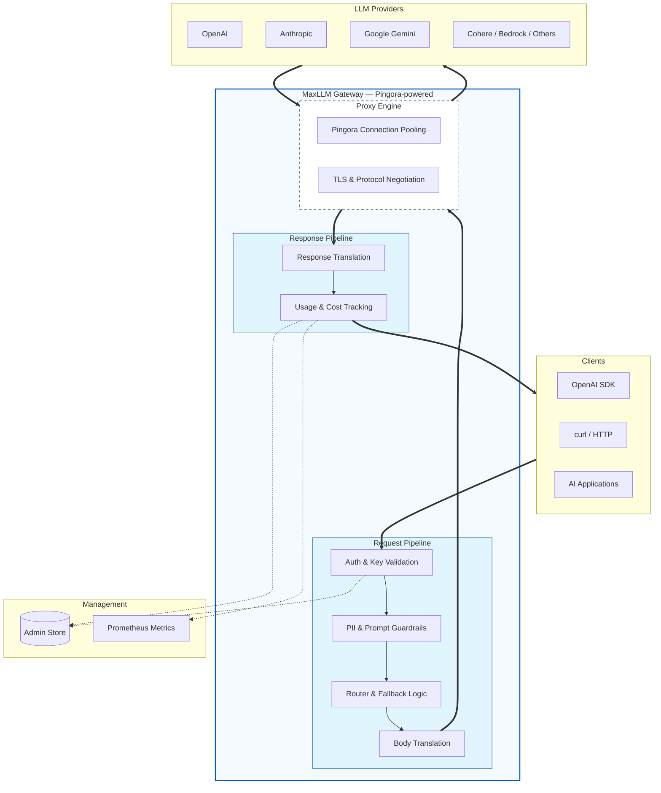
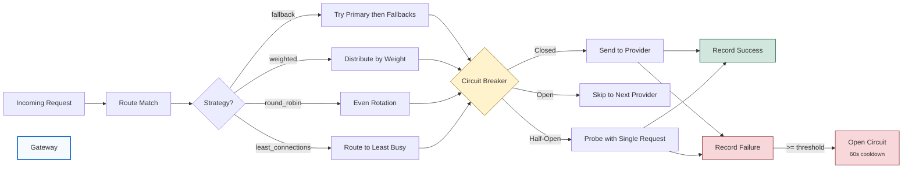

# MaxLLM

[](https://github.com/cloudflare/pingora)
[](https://www.rust-lang.org/)
[](LICENSE)

A high-performance AI gateway built on [Pingora](https://github.com/cloudflare/pingora), the open-source Rust framework that powers a significant portion of Cloudflare's global network. MaxLLM acts as a reverse proxy that accepts OpenAI-format requests and routes them to any supported LLM provider, translating request/response formats transparently.

**One SDK. Any provider. Zero code changes.**

<p align="center">
  
</p>

## Table of Contents

- [Features](#features)
- [Getting Started](#getting-started)
  - [Docker](#option-1-docker-recommended)
  - [CLI](#option-2-cli)
  - [Build from source](#option-3-build-from-source-server-binary-directly)
  - [Send your first request](#send-your-first-request)
  - [Native Provider Endpoints](#native-provider-endpoints)
  - [Pass-Through Endpoints](#pass-through-endpoints)
- [Supported Providers](#supported-providers)
- [Configuration](#configuration)
  - [Providers](#providers)
  - [Routes](#routes)
  - [Auto model (rotation)](#auto-model-rotation)
  - [Plugins](#plugins)
  - [Model Aliases](#model-aliases)
- [Routing Strategies](#routing-strategies)
- [Resilience: Session Stickiness, Circuit Breaking & Recording](#resilience-session-stickiness-circuit-breaking--recording)
  - [Circuit breaker](#circuit-breaker)
  - [Request-level failover (HTTP errors)](#request-level-failover-http-errors)
  - [Rate-limit resolution (exact reset time)](#rate-limit-resolution-exact-reset-time)
  - [Recorder](#recorder)
- [Plugins](#plugins-1)
- [Guardrails](#guardrails)
  - [Providers](#providers-1)
  - [Configuration](#configuration-1)
  - [Request-Level Selection](#request-level-selection)
- [Virtual Keys & Multi-Tenancy](#virtual-keys--multi-tenancy)
- [Observability](#observability)
  - [Prometheus Metrics](#prometheus-metrics)
  - [Response Headers](#response-headers)
- [Architecture](#architecture)
  - [Request Flow](#request-flow)
  - [Routing & Failover](#routing--failover)
- [Performance](#performance)
- [Development](#development)
  - [CLI Options](#cli-options)
  - [Environment Variables](#environment-variables)
- [Why Pingora?](#why-pingora)
- [License](#license)

## Features

- **17 LLM providers** &mdash; OpenAI, Anthropic, Gemini, Azure, Bedrock, Groq, Together, Fireworks, Mistral, xAI, DeepSeek, Ollama, Cohere, DeepInfra, OpenCode, Command Code, OpenDesign, and any OpenAI-compatible endpoint
- **Three input modes** &mdash; OpenAI-format with translation, native provider format (Anthropic Messages API, Gemini, etc.), or raw pass-through
- **Streaming support** &mdash; SSE streaming with real-time format translation (Anthropic SSE, Gemini SSE, Cohere SSE &rarr; OpenAI SSE)
- **Smart routing** &mdash; Fallback chains, weighted load balancing, round-robin, least-connections, with per-provider circuit breakers
- **Session stickiness** &mdash; Pin a conversation to the provider that first served it (session id from `X-Session-ID` / `X-Conversation-ID` / `session-id` / `thread-id` headers, or the request body), so a session never hops between API keys and loses upstream context
- **Resilient circuit breakers** &mdash; Three-state (closed / open / half-open) with bounded half-open probing; an HTTP 429 force-opens a provider until the *exact* quota reset instant (resolved from headers, learned patterns, the error body, or a Laya decision model), so quota-exhausted channels are not retried pointlessly
- **Request recorder** &mdash; JSONL audit trail of every client/provider exchange (hourly rotation, body truncation, retention pruning), same event shape as litellm_lb_go
- **Plugin system** &mdash; 14 built-in plugins (auth, rate limiting, CORS, caching, PII filtering, prompt injection detection, context compaction, and more)
- **Guardrails** &mdash; Content-level guardrails with 8 providers (built-in, webhook, Lakera AI, CEL expressions)
- **Virtual keys** &mdash; Multi-tenant key management with per-key budgets, rate limits, model access control, and team grouping
- **Cost tracking** &mdash; Automatic cost calculation with built-in model pricing for 10+ model families
- **Observability** &mdash; Prometheus metrics, structured tracing, response headers (`X-MaxLLM-Provider`, `X-MaxLLM-Upstream-Ms`)

## Getting Started

### Option 1: Docker (recommended)

The fastest way to run MaxLLM. Multi-platform image available for amd64 and arm64.

```bash
# Pull the image
docker pull chaitanyadev14/maxllm:latest

# Run with your API keys
docker run -d --name maxllm \
  -p 8080:8080 \
  -e OPENAI_API_KEY="sk-..." \
  -e ANTHROPIC_API_KEY="sk-ant-..." \
  -e GEMINI_API_KEY="..." \
  -v $(pwd)/maxllm.toml:/app/maxllm.toml \
  chaitanyadev14/maxllm:latest
```

Or use Docker Compose:

```bash
# Set your API keys in the environment or a .env file
export OPENAI_API_KEY="sk-..."
export ANTHROPIC_API_KEY="sk-ant-..."

# Start the gateway
docker compose up -d

# Check health
curl http://localhost:8080/health
```

### Option 2: CLI

The `maxllm` CLI provides a single-binary entry point for managing the gateway.

```bash
# Build from source
cargo build --release

# Generate a starter config
./target/release/maxllm init

# Set your provider API keys
export OPENAI_API_KEY="sk-..."
export ANTHROPIC_API_KEY="sk-ant-..."

# Start the gateway
./target/release/maxllm start

# Check status
./target/release/maxllm status

# Validate the config / list providers
./target/release/maxllm config check
./target/release/maxllm config providers

# Create a virtual key
export MAXLLM_ADMIN_KEY="your-master-key"
./target/release/maxllm keys create --name "my-app"

# Stop the gateway
./target/release/maxllm stop
```

### Option 3: Build from source (server binary directly)

```bash
# Build
cargo build --release

# Set provider API keys
export OPENAI_API_KEY="sk-..."
export ANTHROPIC_API_KEY="sk-ant-..."

# Run the server directly
./target/release/maxllm-server --config maxllm.toml
```

### Send your first request

Once the gateway is running (any option above):

```bash
curl http://localhost:8080/v1/chat/completions \
  -H "Authorization: Bearer sk-maxllm-dev-key" \
  -H "Content-Type: application/json" \
  -d '{
    "model": "gpt-4o-mini",
    "messages": [{"role": "user", "content": "Hello!"}]
  }'
```

The same request works for any provider &mdash; just change the route:

```bash
# Anthropic (auto-translated to Messages API)
curl http://localhost:8080/v1/anthropic -H "Authorization: Bearer sk-maxllm-dev-key" \
  -H "Content-Type: application/json" \
  -d '{"model": "claude-sonnet-4-20250514", "messages": [{"role": "user", "content": "Hello!"}]}'

# Gemini (auto-translated to generateContent API)
curl http://localhost:8080/v1/gemini -H "Authorization: Bearer sk-maxllm-dev-key" \
  -H "Content-Type: application/json" \
  -d '{"model": "gemini-2.5-flash", "messages": [{"role": "user", "content": "Hello!"}]}'

# Local Ollama
curl http://localhost:8080/v1/ollama -H "Authorization: Bearer sk-maxllm-dev-key" \
  -H "Content-Type: application/json" \
  -d '{"model": "gemma3:1b", "messages": [{"role": "user", "content": "Hello!"}]}'
```

### Native Provider Endpoints

Send requests in the provider's native format &mdash; no translation, full access to provider-specific features:

```bash
# Anthropic Messages API (native format, supports thinking blocks, etc.)
curl http://localhost:8080/v1/messages -H "Authorization: Bearer sk-maxllm-dev-key" \
  -H "Content-Type: application/json" \
  -d '{"model": "claude-sonnet-4-20250514", "max_tokens": 1024, "messages": [{"role": "user", "content": "Hello!"}]}'

# Gemini generateContent API (native format)
curl http://localhost:8080/v1beta/models/gemini-2.5-flash:generateContent \
  -H "Authorization: Bearer sk-maxllm-dev-key" \
  -H "Content-Type: application/json" \
  -d '{"contents": [{"parts": [{"text": "Hello!"}]}]}'
```

### Pass-Through Endpoints

Raw proxy to any provider API path &mdash; zero body parsing, just auth injection:

```bash
# Pass-through to Anthropic (any endpoint)
curl http://localhost:8080/passthrough/anthropic/v1/messages \
  -H "Authorization: Bearer sk-maxllm-dev-key" \
  -H "Content-Type: application/json" \
  -d '{"model": "claude-sonnet-4-20250514", "max_tokens": 1024, "messages": [{"role": "user", "content": "Hello!"}]}'

# Pass-through to OpenAI (any endpoint, including embeddings, images, etc.)
curl http://localhost:8080/passthrough/openai/v1/embeddings \
  -H "Authorization: Bearer sk-maxllm-dev-key" \
  -H "Content-Type: application/json" \
  -d '{"model": "text-embedding-3-small", "input": "Hello world"}'
```

## Supported Providers

| Provider | Kind | Format | Auth |
|----------|------|--------|------|
| OpenAI | `openai` | Passthrough | Bearer token |
| Anthropic | `anthropic` | Full translation | x-api-key |
| Google Gemini | `gemini` | Full translation | API key query param |
| Azure OpenAI | `azure_openai` | Passthrough | api-key header |
| AWS Bedrock | `bedrock` | Anthropic format | AWS SigV4 |
| Groq | `groq` | OpenAI-compatible | Bearer token |
| Together AI | `together` | OpenAI-compatible | Bearer token |
| Fireworks AI | `fireworks` | OpenAI-compatible | Bearer token |
| DeepInfra | `deepinfra` | OpenAI-compatible | Bearer token |
| Mistral AI | `mistral` | OpenAI-compatible | Bearer token |
| xAI (Grok) | `xai` | OpenAI-compatible | Bearer token |
| DeepSeek | `deepseek` | OpenAI-compatible | Bearer token |
| Ollama | `ollama` | OpenAI-compatible | None (local) |
| Cohere | `cohere` | Full translation | Bearer token |
| OpenCode (opencode.ai "zen") | `opencode` | OpenAI-compatible + strict schema | Bearer token |
| Command Code (commandcode.ai) | `commandcode` | OpenAI-compatible + native Responses + Anthropic Messages | Bearer token |
| OpenDesign (open-design.ai) | `open_design` | OpenAI-compatible + native Responses | Bearer token |
| Custom | `openai_compat` | OpenAI-compatible | Configurable |

> **Command Code** is reachable through the vendor's **Provider API**
> (`/provider/v1/*`) — the sanctioned path — which needs the paid Provider
> plan (the Go plan answers `403 upgrade_required`). The vendor's other
> surface (`/alpha/*`) is the private wire protocol of their own `cmd`
> client and answers "This endpoint only serves CLI"; proxying a
> subscription through it violates the vendor's terms, so the gateway does
> not speak it. Upgrade the plan and `/v1/responses/cmd` lights up with no
> translation — native Responses, byte-for-byte forwarding.

> **AWS Bedrock** authenticates with AWS Signature V4. Credentials are read
> from `AWS_ACCESS_KEY_ID` / `AWS_SECRET_ACCESS_KEY` (no STS assume-role
> chain), and the region from the provider's `region` config key, then
> `AWS_REGION`, defaulting to `us-east-1`. The model is routed into the
> upstream URL (`/model/{id}/invoke`), so the body's `model` field is
> stripped by the translator. Only one endpoint is proxied with a full
> buffered request because the signature covers the payload hash:
>
> ```toml
> [providers.my_bedrock]
> kind = "bedrock"
> base_url = "https://bedrock-runtime.us-east-1.amazonaws.com"
> region = "us-east-1"
> ```


## Configuration

MaxLLM uses a single TOML config file with `${ENV_VAR}` expansion. See [maxllm.toml](maxllm.toml) for a full example.

### Providers

```toml
[providers.openai]
kind = "openai"
base_url = "https://api.openai.com"
api_key = "${OPENAI_API_KEY}"
default_model = "gpt-4o"

[providers.anthropic]
kind = "anthropic"
base_url = "https://api.anthropic.com"
api_key = "${ANTHROPIC_API_KEY}"
default_model = "claude-sonnet-4-20250514"
```

### Routes

Routes support four endpoint types:

| Type | Config Value | Description |
|------|-------------|-------------|
| **Translated** | `chat_completions` (default) | Client sends OpenAI format; gateway translates to/from provider |
| **Native** | `native` | Client sends provider-native format; gateway forwards as-is with metadata extraction |
| **Pass-through** | `passthrough` | Raw reverse proxy; zero body parsing, just auth + logging |

```toml
# Translated (default) — OpenAI format in, provider format out
[[routes]]
path = "/v1/chat/completions"
provider = "openai"
fallback = ["anthropic", "groq"]
strategy = "fallback"
timeout_secs = 120
plugins = ["rate_limiter", "cors"]
guardrails = ["injection-guard"]

# Responses — OpenAI Responses API contract (input/instructions/output);
# gateway translates to/from chat completions for any provider
[[routes]]
path = "/v1/responses"
provider = "openai"
endpoint_type = "responses"
plugins = ["rate_limiter", "cors"]

# Native — Anthropic Messages API format directly
[[routes]]
path = "/v1/messages"
provider = "anthropic"
endpoint_type = "native"
plugins = ["rate_limiter", "cors"]

# Native — Gemini generateContent format directly
[[routes]]
path = "/v1beta/models"
provider = "gemini"
endpoint_type = "native"
plugins = ["rate_limiter", "cors"]

# Pass-through — raw proxy to any Anthropic endpoint
[[routes]]
path = "/passthrough/anthropic"
provider = "anthropic"
endpoint_type = "passthrough"
plugins = ["rate_limiter"]
```


### Auto model (rotation)

An auto sentinel model rotates across an explicit pool of `(provider, model)`
pairs. Pools are declared in the gateway's own config, so a rotation set never
reads one-api's channel table and stays stable even if one-api is not running.
A route with `auto_model = true` selects from a pool instead of its own
`provider`/`fallback` chain.

`[auto_model]` is the default pool (sentinel `auto`); `[auto_models.<key>]`
declares further pools, each answering to its own sentinel name. Keep the
rotation sets disjoint — e.g. cloud vendors under `auto` and home / on-prem
GPUs under `auto_home`, so a request that asks for `auto` never lands on a
machine at home (and vice versa). Split by **where the model runs**, not by
where the host sits: a LAN box that only proxies to a cloud-hosted model
belongs to the cloud pool, while a GPU serving its own weights belongs to the
home pool.

```toml
[auto_model]              # sentinel "auto": cloud vendors
enabled = true
[[auto_model.pool]]
provider = "volc_1"
model = "deepseek-v4-flash"

[auto_models.auto_home]   # sentinel "auto_home": home GPUs
[[auto_models.auto_home.pool]]
provider = "oleworkstation_minicpm"
model = "minicpm5-2b-256k-swa-gpu3"

[[routes]]
path = "/v1/cloud"
provider = "auto"          # a pool name, not a [providers.*] key
auto_model = true

[[routes]]
path = "/v1/home"
provider = "auto_home"     # selects that pool
auto_model = true
```

A pool's sentinel is the table key (`[auto_models.auto_home]` → `auto_home`)
unless the block sets `name`. For an `auto_model = true` route the route's
`provider` names the pool it rotates over when it matches one; otherwise the
first declared pool (the default `[auto_model]`) serves it. Every enabled pool
is also listed by `GET /v1/models` with `owned_by: "maxllm-auto"`, so a client
can discover the sentinels. Pool names must be unique, and a route naming a
pool that is missing or disabled fails config validation at startup.

Selection is **session-sticky first** — a session pinned to a pool provider
keeps using it (unless that provider's circuit opens) so the upstream keeps
its context — then **round-robin** over the healthy entries. The request
body's `model` field is rewritten to the selected entry's model before it
goes upstream, so the upstream never sees the sentinel. Failover re-selects
within the pool (skipping attempted / open-circuit entries), and DNS
resolution failures share the connect-failure path (breaker + switch).

#### Billing tiers — subscription before metered

A pool entry declares how it is paid for with `billing`:

```toml
[auto_model]
enabled = true

[[auto_model.pool]]
provider = "volc_1"        # prepaid plan (subscription is the default)
model = "deepseek-v4-flash"

[[auto_model.pool]]
provider = "deepseek"      # pay-per-token balance
model = "deepseek-flash"
billing = "metered"
```

`billing` accepts `subscription` (the default, so older configs are
unchanged) and `metered`. Selection is **tiered, not ordered**: while at
least one subscription entry is usable (provider present, circuit closed, not
already tried in this request), the pool rotates only over the subscription
entries. A metered entry is reached only once every subscription entry is
unavailable — regardless of where it sits in the pool — and the failover walk
follows the same rule, so one request cannot downgrade to a pay-per-token key
while a prepaid plan can still serve. Session-sticky is tier-scoped too: a
session pinned to a metered entry is moved back to the subscription tier as
soon as any subscription entry can serve again (the upstream context is lost
once, which is the price of the policy).

`GET /metrics` exposes `maxllm_auto_pool_metered_selections_total` — pool
selections that had to leave the subscription tier. It should only move while
the prepaid plans are genuinely down.

```toml
[auto_model]
enabled = true
name = "auto"

[[auto_model.pool]]
provider = "openai"
model = "gpt-4o"

[[auto_model.pool]]
provider = "anthropic"
model = "claude-sonnet-4-20250514"

# The route's `provider` is a sentinel (not a [providers.*] key);
# the request model "auto" gets rewritten to the selected entry's model.
[[routes]]
path = "/v1/responses/auto"
provider = "auto"
endpoint_type = "responses"
auto_model = true
session_sticky = true
```

Pool entries naming an unknown provider are dropped at startup (with a warn),
so a typo cannot silently shrink the pool. The auto route must come before
any broader prefix route (`match_route` takes the first prefix match).

The same rule governs every per-provider Responses route: `/v1/responses/<provider>`
must be declared **before** a generic `/v1/responses` route, otherwise the
generic one wins the prefix match and the request never reaches the provider
it names (it is answered by that route's fallback chain instead).

The sentinel is recognised on **any** route, not only on routes that declare
`auto_model = true`. A client that selects `auto` in its model picker usually
keeps its base URL on the summary route — only the model string changes — so
the body's sentinel is read **before** the pool is chosen and it decides the
pool outright: `auto_home` on `/v1/responses/auto` runs on the home pool, and
`auto` on `/v1/responses/auto_home` runs on the vendor pool. (This read used
to be skipped whenever the client sent a session header — codex sends
`session-id` on every request — which silently left the body's sentinel
unused and served the route's pool instead.) Without the early read the first
attempt would reach that route's own provider, which has no model by that
name and answers 404. Rather than walking the route's fallback chain
(every entry of which would answer the same 404 and leave the client with a
502), the walk switches into the pool **named by the sentinel** (each pool is
recognised by its own name: `auto_home` never enters the `auto` pool),
rewrites the body's `model` to the selected entry's model, and serves the
request there. `ctx.auto_pool` pins the pool for the rest of the request, so a
failover never crosses from one rotation set into another. The cost
is one rejected attempt (a few hundred milliseconds); the alternative is a
hard failure for a model the client never meant to name.

A session that is already pinned to a pool member keeps that member, and the
rewrite still applies: the pinned entry's model replaces the sentinel, so the
sentinel itself never reaches an upstream. That matters for members that do
not validate model names — a llama.cpp-style server accepts `auto` and quietly
serves whatever model it happens to host.

When a request runs out of attempts, the 502 message lists every provider that
was tried (`provider=status`, `provider=connect`, `provider=dns`), so a
trailing DNS failure on the last pool member no longer hides the real answers
of the others (typically `404 UnsupportedModel`).

The same rewrite covers a sentinel that only exists in the body: on a plain
route the provider is picked before the body is read, so a request that lands on
a pool member (a pinned session, or a route whose own provider is listed in the
pool) gets its `model` rewritten to that entry's model instead of being rejected
and bounced to a different member — which would also lose the upstream's prompt
cache for every turn of the conversation.

### Failover with a large request body

Pingora keeps at most 64 KiB of the client body for a replay and silently drops
the rest. An agent request is much larger (codex sends ~100 KB of instructions
and tool schemas), so a failover used to hand the next upstream a truncated
body: the upstream waited for the rest while the client waited for a response,
and the turn went silent for minutes (measured: 391 s). The gateway keeps the
client body itself (`ctx.client_body`) and re-feeds it whole — re-translated for
the new provider, whose model name differs — through `request_body_filter`.

That needs one condition in pingora-proxy to call the filter even when the
replay buffer truncated. The one-line patch is vendored in
`vendor/pingora-proxy` (see `vendor/README.md` and
`vendor/pingora-proxy-maxllm.patch`); upstream 0.9.1 still has the old
condition.

### A pool member that accepts the connection and hangs up

A model server that crashed, or a supervisor still holding the listen socket
while the worker is gone, accepts the TCP connection and closes it before
sending a single byte. Pingora reports that as `ConnectionClosed` while reading
the response headers, and by default only replays such an error on a *reused*
connection — so a dead pool member used to hand the client a hard 502 while the
rest of the pool sat idle, which is exactly how a client ends up in a
multi-minute backoff loop.

The gateway now treats "the upstream died before answering" (`upstream_responded
== false`, connection closed / read error / read timeout) like a connect
failure: it counts against the member's circuit breaker, unpins the session and
replays the request on the next pool entry or fallback, bounded by the route's
failover budget. Errors that arrive *after* the upstream produced headers are
never replayed — that request may already have been executed and billed.

### Checking pool health

`scripts/pool_health.py` probes every entry of every enabled pool (the default
`[auto_model]` and each `[auto_models.<key>]`) through its own
`/v1/responses/<provider>` route (no rotation, no failover, so each answer is
attributable) and prints the pool, status, latency and the upstream's error
message. `--pool` narrows it to one sentinel (or a comma list):

```bash
python3 scripts/pool_health.py --config maxllm.toml --env-file maxllm.env
# pool=25 healthy=12 failed=13 elapsed=32.7s
# ok   200   1463ms auto          volc_1              deepseek-v4-flash  text='ok'
# BAD  403    102ms auto          zhipu_1             glm-5.3-flash      {"code": "model_access_denied", ...}
python3 scripts/pool_health.py --config maxllm.toml --pool auto_home --env-file maxllm.env
```

It exits non-zero when any member fails, so it can gate a deploy. Every probe
carries `X-MaxLLM-Probe: 1`, so a scheduled probe does not pollute the metrics
or request log it is meant to explain.

Running it on a schedule turns "a member died three hours ago" into "a member
died five minutes ago" — a systemd timer is enough:

```ini
# maxllm-pool-health.service  (Type=oneshot, SuccessExitStatus=0 1)
ExecStart=/usr/bin/python3 pool_health.py --config maxllm.toml --env-file maxllm.env

# maxllm-pool-health.timer
[Timer]
OnBootSec=2min
OnUnitActiveSec=5min
```

### Log rotation and recordings retention

`scripts/rotate_logs.py` rotates the append-only service logs
(`maxllm.log`, `maxllm.err`) by size and prunes old
`recordings/*.jsonl`. The unit writes them with systemd's `append:` target,
which opens the file once with `O_APPEND`; that makes plain truncation safe —
every write continues at the current end of file, so the writer never leaves a
sparse hole and the gateway needs no signal or restart.

```bash
python3 scripts/rotate_logs.py --dir logs --recordings-dir recordings \
    --max-bytes 20971520 --recordings-days 14
```

## OpenCode (opencode.ai "zen") conversion

`kind = "opencode"` proxies `https://opencode.ai` with OpenAI-compatible wire
format but stricter validation than most providers. The gateway applies a
complete, idempotent request-conversion pass before forwarding:

* **Session header** — opencode.ai rejects requests without an
  `x-opencode-session` header (`400 MissingSessionID`). The gateway forwards
  the client's own header verbatim; when absent it injects the client's
  `x-session-affinity` / `x-opencode-session-id`, or a fresh UUID.
* **`tool_choice`** — the non-standard `"any"` (codex-cli) maps to
  `"required"`; a `tool_choice` sent with no tools is dropped.
* **Tool calls** — `arguments` are coerced to JSON strings (missing →
  `"{}"`), `type` defaults to `"function"`, empty `function.name` /
  `tool_call.id` are repaired, orphan/forward-reference tool messages are
  dropped and missing tool responses are synthesised.
* **Reasoning** — `reasoning`/`reasoning_text` dialects are mirrored into
  `reasoning_content`; thinking-mode turns get a placeholder (echo collapse
  prevents snowballing). Set `skip_reasoning_injection = true` to disable the
  placeholder.
* **Responses API** — `/zen/go/v1/responses` serves the Responses contract
  natively, so `kind = "opencode"` defaults to `native_responses = true` and
  `/v1/responses` requests are forwarded byte-for-byte. A request carrying
  chat-style nested function tools (`{"type":"function","function":{…}}`) is
  flattened to the official Responses shape, which the upstream rejects
  otherwise.
* **Streaming usage** — token usage is extracted from chat and Responses SSE
  streams for the ledger/metrics, and the cost the upstream reports
  (`usage.opencode.allowance`) is recorded when the model has no price-table
  entry.

```toml
[providers.opencode]
kind = "opencode"
base_url = "https://opencode.ai"
upstream_path = "/zen/go/v1/chat/completions"
api_key = "${OPENCODE_API_KEY}"
default_model = "deepseek-v4.1-flash"
# opencode.ai's Cloudflare edge can be slow/lossy from some hosts (TCP
# connect measured up to 15s); widen the default 10s connect budget so a
# slow-but-healthy upstream does not turn into a 502.
connect_timeout_secs = 30
total_connect_timeout_secs = 60
```

## Command Code (commandcode.ai) provider

`kind = "commandcode"` proxies `https://api.commandcode.ai` — one key and one
credit balance for Claude, GPT, Gemini and the open models. The vendor
namespaces every route under `/provider` and speaks three wire contracts:

| Upstream path | Contract | Serves |
|---------------|----------|--------|
| `/provider/v1/responses` | OpenAI Responses | every non-Claude model that lists `/responses` |
| `/provider/v1/chat/completions` | OpenAI Chat Completions | every non-Claude model |
| `/provider/v1/messages` | Anthropic Messages | the Claude models **only** |

What the gateway does with it:

* **Responses first** — the upstream serves the Responses contract natively
  (verified 2026-11-08: the route answers `401` without a key, so it exists),
  so `kind = "commandcode"` defaults to `native_responses = true` and
  `/v1/responses` requests are forwarded byte-for-byte to
  `/provider/v1/responses`. The default model is `deepseek/deepseek-v4.1-flash`
  — the one model this deployment advertises for the vendor.
* **Bearer auth everywhere** — every route authenticates with
  `Authorization: Bearer <CMD_API_KEY>`, including the Anthropic-shaped one
  (commandcode.ai does *not* accept Anthropic's `x-api-key`).
* **Claude models** — they are served on the Anthropic Messages route only.
  Give them their own provider entry: the gateway then translates an
  OpenAI-format request into the Anthropic Messages contract (and the answer
  back), and a native `/v1/messages` request is forwarded to
  `/provider/v1/messages` — the client can keep speaking the plain Anthropic
  contract.
* **Cost** — the Provider plan is pay-as-you-go at the underlying API rate, so
  the price table carries the vendor's DeepSeek V4.1 Flash rate
  (off-peak `$0.15` / `$0.60` per 1M tokens). Override it in
  `[model_costs."deepseek/deepseek-v4.1-flash"]` if your contract differs.
* **User-Agent** — the vendor's Cloudflare edge bans script fingerprints
  (`Python-urllib/3.11` → HTTP 403 `error code: 1010`), exactly like
  opencode.ai's. The gateway swaps a banned UA for `curl/8.5.0` on every
  commandcode request; other client UAs are forwarded untouched.

```toml
[providers.cmd]
kind = "commandcode"
base_url = "https://api.commandcode.ai"
api_key = "${CMD_API_KEY}"
default_model = "deepseek/deepseek-v4.1-flash"
# native_responses defaults to true for kind = "commandcode"

# The Claude models, on the vendor's Anthropic Messages route.
[providers.cmd_claude]
kind = "commandcode"
base_url = "https://api.commandcode.ai"
upstream_path = "/provider/v1/messages"
api_key = "${CMD_API_KEY}"
default_model = "claude-sonnet-5-5"

# Per-provider path: declare it BEFORE any generic "/v1/responses" route
# (route matching is prefix based, first match wins).
[[routes]]
path = "/v1/responses/cmd"
provider = "cmd"
endpoint_type = "responses"
```

> **Plan gate.** The vendor's API routes are a paid add-on: the Go plan
> covers the CLI only, and every call to `/provider/v1/*` then answers HTTP 403
> `upgrade_required` ("Your Go plan doesn't include API access"). The Provider
> plan ($15/mo) unlocks them. The gateway forwards that error verbatim.

The full vendor catalogue (ids, context lengths and the endpoints each model
is served on) is published at `GET https://api.commandcode.ai/provider/v1/models`
— the gateway advertises only the models a deployment actually configures.

## OpenDesign (open-design.ai) provider

`kind = "open_design"` proxies the OpenDesign **AMR link** — the
OpenAI-compatible endpoint the design workspace's cloud runtime reaches its
model vendors through. One `sk-amr-…` key, one credit balance, the models the
account's plan carries:

| Upstream path | Contract | Serves |
|---------------|----------|--------|
| `/v1/responses` | OpenAI Responses | every chat model (native, streaming) |
| `/v1/chat/completions` | OpenAI Chat Completions | every chat model |
| `/v1/models` | OpenAI model list | the account's catalogue |

**The gateway speaks the link natively — no CLI is involved.** Nothing is
shelled out to: the `od` / `vela` binaries are never spawned, the link's
protocol is implemented in Rust
(`crates/maxllm-translate/src/open_design.rs`), and the workspace's own
account management stays where it belongs (the OpenDesign app).

What the gateway does with it:

* **Responses first** — the link serves the Responses contract natively
  (verified 2026-11-08 against the live endpoint: `POST /v1/responses`
  answers a Responses object, and `stream: true` emits the `response.*` SSE
  event family), so `kind = "open_design"` defaults to
  `native_responses = true` and `/v1/responses` requests are forwarded
  byte-for-byte to `/v1/responses`. `store`, `previous_response_id`,
  `include`, `reasoning.effort` and `text.verbosity` all survive the forward.
* **`tool_choice: "any"` is rewritten** — the link rejects the non-standard
  value with HTTP 400 `upstream_error` (codex-cli sends it), so the gateway
  rewrites it to `"required"`, the OpenAI value with the same meaning.
  `"auto"`, `"none"` and `"required"` are forwarded untouched. The rewrite
  runs on **both** contracts — the chat path and the native Responses path —
  because the link rejects `"any"` on `/v1/responses` too. Since the repaired
  body no longer matches the client's `Content-Length`, the native Responses
  requests for this provider travel chunked (the link accepts chunked
  bodies); every other provider keeps the byte-for-byte `Content-Length`
  framing.
* **Bearer auth** — every route authenticates with
  `Authorization: Bearer <OPEN_DESIGN_API_KEY>`.
* **The link's extensions survive** — the assistant message carries
  `reasoning_details[]` (the OpenRouter shape) and the usage block carries
  `prompt_tokens_details.cached_read_tokens` /
  `completion_tokens_details.reasoning_tokens`. Both are passed through
  verbatim; the gateway's own accounting reads the standard token fields.
* **Unknown models fail over** — the link answers HTTP 404
  `{"error":{"code":"model_not_found"}}`, which the gateway already treats as
  a failover trigger, so a request for a model the account does not carry
  walks the fallback chain instead of failing outright.
* **Cost** — the link draws down a prepaid credit balance and reports no
  per-request USD cost, so `deepseek-v4.1-flash` is booked at 0 (like the
  other prepaid channels). Override it in
  `[model_costs."deepseek-v4.1-flash"]` if you want the credit draw booked.

```toml
[providers.open_design]
kind = "open_design"
base_url = "https://amr-link.open-design.ai/v1"
api_key = "${OPEN_DESIGN_API_KEY}"
default_model = "deepseek-v4.1-flash"
# native_responses defaults to true for kind = "open_design"
# The gateway connects to the base_url's origin and routes to the link's own
# paths (/v1/chat/completions, /v1/responses, /v1/models).

[[routes]]
path = "/v1/open-design"
provider = "open_design"
timeout_secs = 120
plugins = ["rate_limiter", "cors"]

# Per-provider path: declare it BEFORE any generic "/v1/responses" route
# (route matching is prefix based, first match wins).
[[routes]]
path = "/v1/responses/open-design"
provider = "open_design"
endpoint_type = "responses"
```

The account's catalogue (which models it carries, their context limits and
their credit tier) is published at `GET /v1/models` on the link. The gateway
advertises the chat models OpenDesign's own runtime prefers —
`deepseek-v4.1-flash`, `deepseek-v4-flash`, `deepseek-v4-pro` — and the
`default_model` a deployment configures.

### Native Responses: required whenever the upstream serves it

`kind = "opencode"` is not the only upstream that serves the Responses
contract. **Any provider whose upstream serves it must be configured
`native_responses = true`** — the gateway then forwards `/v1/responses`
requests byte-for-byte instead of translating them down to chat completions.
Translation is a fallback for upstreams with no Responses route, and each such
fallback has to be a recorded exemption (a probed 404, noted in the config and
in `scripts/check_responses_policy.py`), not a silent default. See
`CLAUDE.md` § "Responses Contract Policy (MUST)" for the probe, the config
rules and the gate:

```toml
[providers.kimi]
kind = "openai_compat"
base_url = "https://api.kimi.com"
upstream_path = "/coding/v1/chat/completions"   # the chat half
default_model = "kimi-for-coding"               # 1M context (see /coding/v1/models)
native_responses = true
responses_path = "/coding/v1/responses"         # optional: derived from upstream_path
```

The path is derived from `upstream_path` (`…/chat/completions` →
`…/responses`) when `responses_path` is omitted, so `native_responses = true`
alone usually suffices. Verified against the live endpoints on 2026-11-08 by
posting a minimal Responses body to the derived path:

| provider | derived path | result |
|---|---|---|
| `volc_1/2` | `/api/coding/v3/responses` | 200 |
| `volc_t_1` | `/api/plan/v3/responses` | 200 |
| `minimax` | `/v1/responses` | 200 |
| `xiaomi` | `/v1/responses` | 200 |
| `ollama_local` | `/v1/responses` | 200 |
| `deepseek` | `/v1/responses` | 200 |
| `kimi` | `/coding/v1/responses` | quota 429 (route exists) |
| `olefedora_gpu0_minicpmv47`, `coding_home_olefedora_gpu0`, `humanizer_gpu3` | `/v1/responses` | 200 (sglang / llama.cpp) |
| `zhipu_1` | derived `/api/coding/paas/v4/responses` → **`/api/v1/responses`** | derived path 404; vendor path 429 (route exists, weekly quota exhausted until 2026-11-10 22:58:54) — so `responses_path` is set explicitly |

Two ways to tell whether a request is being translated or forwarded natively:
a translated request must carry `input` (the gateway rejects it with `400
invalid Responses request: responses request is missing 'input'` before it
ever leaves the process), while `native_responses = true` forwards whatever
the client sent and the *upstream* answers — verified live: a body with no
`input` gets kimi's own weekly-quota `429`, and volc's own
`400 MissingParameter … missing \`input\` parameter` with a volc request id.
Verify an opt-in end-to-end without depending on the upstream's quota by
pointing `responses_path` at a bogus path for one call — the upstream's own
404 (rather than the gateway's validation error) proves the path is in use.

A derived path that 404s is **not** a reason to fall back to translation: probe
the vendor's documented Responses route and set `responses_path` (zhipu is
exactly that case). Only a provider with no Responses route at all keeps the
chat translation, and that state is enumerated in
`scripts/check_responses_policy.py`:

```bash
python3 scripts/check_responses_policy.py --config maxllm.toml          # static
python3 scripts/check_responses_policy.py --config maxllm.toml --live   # probe routes
```

For pass-through routes, the path suffix after the route prefix is forwarded to the upstream provider (e.g., `/passthrough/anthropic/v1/messages` proxies to `https://api.anthropic.com/v1/messages`).

### Shutdown behaviour

On `SIGTERM` the gateway stops accepting new connections and drains the
in-flight ones for `grace_period_secs` (default 30) before tearing the
runtimes down:

```toml
[server]
listen = "0.0.0.0:8080"
grace_period_secs = 30
```

Keep this below the service manager's stop timeout so the process exits on
its own — Pingora's own default is 300s, which a manager would answer with a
`SIGKILL` in the middle of the shutdown.

### Plugins

```toml
global_plugins = ["request_id", "api_auth"]

[plugins.api_auth]
category = "key_auth"
header = "Authorization"
strip_prefix = "Bearer "
keys = ["sk-maxllm-dev-key"]

[plugins.rate_limiter]
category = "rate_limit"
requests_per_minute = 600
key = "client_ip"
```

### Model Aliases

```toml
[model_aliases]
"gpt-4" = "gpt-4o"
"claude-3" = "claude-sonnet-4-20250514"
```

## Routing Strategies

| Strategy | Config Value | Description |
|----------|-------------|-------------|
| Fallback | `fallback` | Try primary provider, then fallbacks in order (default) |
| Weighted | `weighted` | Distribute traffic by configured provider weights |
| Round Robin | `round_robin` | Even distribution across all providers |
| Least Connections | `least_connections` | Route to the provider with the fewest requests currently in flight |
| Latency Based | `latency_based` | Route to the provider with the lowest observed upstream latency (EWMA over successful attempts) |
| Cost Based | `cost_based` | Route to the cheapest provider by blended USD price per 1M tokens (from the model price table) |

`latency_based` ranks providers by an exponentially weighted moving average
of the time to the upstream's first byte; a provider with no measurement yet
is ranked last, but stays eligible, so a fresh provider is never locked out.
`cost_based` looks up each provider's `default_model` in the price table and
ranks by input+output price per 1M tokens; a provider whose model has no
price entry is ranked last but stays eligible, so the route is never left
unserved over a missing price line.

All strategies include automatic **circuit breaking**: providers are temporarily removed from rotation after consecutive failures (default: 3 failures, 60s recovery). The circuit breaker is lock-free (AtomicU32/U64).


## Resilience: Session Stickiness, Circuit Breaking & Recording

A port of the resilience trio from [litellm_lb_go](https://github.com/oliveagle/litellm_lb_go) onto maxllm.

### Session stickiness

A conversation is bound to one upstream provider so every turn of the same
session hits the same API key — different keys do not share provider-side
context, so a session that hops between channels loses the thread and answer
quality drops.

The session id is resolved, most-explicit first (same precedence as
litellm_lb_go):

| Source | Spelling |
|---|---|
| Header | `X-Session-ID`, `X-Conversation-ID` (Anthropic style, Claude Code) |
| Header | `session-id`, `thread-id` (codex-cli) |

Session identity is resolved from the request **headers** only. The body
spellings (`metadata.user_id`, `client_metadata.session_id`,
`prompt_cache_key`) are not consulted for routing: the provider has to be
picked before the body is read, so a body-only session id never reaches the
sticky lookup (see `resolve_from_body` — kept only for the recorder).

Two switches must both be on: the global `[session_sticky]` section and the
route-level `session_sticky = true`. The binding is written only after the
provider answers 2xx, and is dropped when the pinned provider fails, so a
session re-pins to a healthy channel.

```toml
[session_sticky]
enabled = true
timeout_secs = 3600   # binding lifetime since last use
max_entries = 10000   # LRU cap

[[routes]]
path = "/v1/responses"
provider = "ollama_local"
fallback = ["volc_1", "minimax", "..."]
strategy = "fallback"
endpoint_type = "responses"
session_sticky = true   # opt-in
```

### Circuit breaker

Three states (closed → open → half-open), lock-free, backed by atomics:

- **Closed** — healthy; failures count against `max_fails`.
- **Open** — `max_fails` reached within the fail window, or an HTTP 429
  force-opened the provider until `Retry-After` (or the fail window) passes.
  Requests are not routed to it.
- **Half-open** — the fail window elapsed, so a bounded number of probe
  requests (`half_open_max`) is admitted; `successes_to_close` successes close
  the circuit, a probe failure re-opens it.

Breakers live in a process-wide map (not in the reloadable `HotState`), so a
config hot-reload — which rebuilds every provider — does not reset breaker
state. Configured per provider:

```toml
[providers.kimi]
kind = "openai_compat"
base_url = "https://api.kimi.com"
upstream_path = "/coding/v1/chat/completions"
api_key = "..."
max_fails = 3
fail_timeout_secs = 60
```

Prometheus metrics: `maxllm_circuit_breaker_state{provider}` (0=closed,
1=open, 2=half-open), `maxllm_circuit_breaker_transitions_total{provider}`,
`maxllm_circuit_breaker_quota_opens_total{provider}` (429 force-opens),
`maxllm_circuit_breaker_stream_opens_total{provider}` (truncation demotions).

#### Stream truncation demotes a provider

A provider that answers `200` and then drops the body mid-stream is invisible
to the plain failure counter: the status was a success, so `record_success`
resets the streak and the provider keeps every byte of the traffic. A
*consecutive*-failure breaker cannot catch it either — for a provider that
truncates ~40% of its streams independently, three failures in a row is a ~6%
event, so the circuit would essentially never trip.

The breaker therefore also measures the truncation **ratio** over a one-minute
window. Once at least 4 judged streams in the window were truncated *and* they
are at least 25% of them, the circuit is force-opened. Routing skips open
circuits, so the route's traffic moves to the next fallback provider; after the
cool-down the provider gets a probe window to prove itself again. This is
counted once per demotion (`stream_opens`) and reported by the
`maxllm-stream-demotions` alert.

The hold **escalates**: consecutive demotions with no clean window in between
are put away for 1 min, 5 min, 15 min, then 30 min (never shorter than the
provider's own `fail_timeout_secs`). Without that, a systematically broken
provider — the ollama endpoint truncated ~34% of its streams for a day — would
be demoted, restored 60 s later, truncate four more answers in its first
minute, and be demoted again: a flap that costs the client a broken answer per
cycle and never really takes the provider out of service. A window that
carries at least 4 judged streams with **zero** truncations is proof of
recovery and resets the ladder to the first step.

Consequences worth knowing:

- Truncation is only judged on dialects the gateway actually parses —
  `chat/completions`, `completions` and the Responses contract. `native` and
  `passthrough` routes speak provider-specific SSE grammars (Anthropic ends on
  `message_stop`, Gemini on `finishReason`), so they are never demoted for a
  missing OpenAI marker.
- A terminal marker split across two upstream chunks is still recognised: the
  detector keeps a tail window across chunk boundaries, so a healthy stream is
  never booked as truncated because of a TCP read boundary.
- On a route with a single provider, demoting it makes that route answer `503`
  until the fail window elapses. That is deliberate (a broken stream is worse
  than a fast failure) but it is the reason to keep a second provider in every
  fallback chain.

### Request-level failover (HTTP errors)

Beyond connect failures, an upstream that *answers* with an error is now
failed over to the next provider of the route's fallback chain, exactly like
[litellm_lb_go](https://github.com/oliveagle/litellm_lb_go) and one-api walk
their channel pools: you only add supply to the pool, and maxllm keeps the
supply stable — a provider whose quota is exhausted (429), that rate limits,
answers 5xx, rejects auth (401/403) or does not carry the requested model
(404, or a 400 "unknown model") is swapped out transparently before the
client sees anything.

| Status | Fails over? |
|---|---|
| `429` rate limit / quota | yes (breaker force-opens on 429) |
| `401`, `402`, `403`, `404`, `405`, `408`, `409`, `410`, `425` | yes |
| `5xx` server errors | yes |
| `400` / `422` | only when the provider does not carry the requested model (its `default_model` differs from the request) — a genuine request fault is not re-sent |
| `2xx` / `3xx` | no |

The walk is bounded per route by `max_failover_attempts` (default 6), so a
request never loops. The failed attempt is invisible to the client: the
provider's answer is discarded and the whole upstream attempt — including the
request-body translation — is replayed on the next provider. When every
provider of the pool fails, the client receives the **last** provider's error.

A transient server error can also be replayed on the **same** provider before
the pool is walked at all — `num_retries` (default 0) is the number of such
retries and `retry_backoff_ms` (default 500) the pause between them:

```toml
[[routes]]
path = "/v1/chat/completions"
provider = "openai"
fallback = ["anthropic"]
num_retries = 2          # replay a 5xx on the same provider twice
retry_backoff_ms = 250   # pause between those retries
```

Only HTTP 5xx is retried this way: a 429 (quota exhausted), a 401/403 (auth
rejected) or a 404 (model missing) would be answered the same way again, so
those move on to the next provider immediately, as does a connect failure. A
retry is also skipped once the provider's circuit breaker is open.

```toml
[[routes]]
path = "/v1/responses"
provider = "ollama_local"
fallback = ["volc_1", "minimax", "opencode_go_1", "..."]
strategy = "fallback"
max_failover_attempts = 6   # how many providers one request may walk
```

Failing over to an opencode.ai provider converts the request to opencode's
schema — the body is re-normalised (message roles, `tool_choice`, tool-call
`arguments` as JSON strings, session header) by the opencode translator
before it is sent, so a raw chat body is never forwarded as-is.

Prometheus metrics: `maxllm_http_failovers_total{from_provider,to_provider,
status}` counts each HTTP-error failover; `maxllm_fallbacks_total` counts
every provider switch (connect + HTTP);
`maxllm_provider_retries_total{provider,status}` counts the same-provider
retries.

### Rate-limit resolution (exact reset time)

A 429 is not "try again in 60 s" — the provider usually states *when* the
quota resets, and retrying before then is wasted work (and hammers a channel
that is known to be exhausted). maxllm resolves the reset instant in four
layers, cheapest first:

| Layer | Source | Cost | Answers |
|---|---|---|---|
| 1. **Headers** | `Retry-After`, `x-ratelimit-reset-requests/tokens`, `x-ratelimit-reset`, `retry-after-ms`, `x-ms-retry-after-ms`, `anthropic-ratelimit-*-reset`, `ratelimit-reset` | none | the reset instant |
| 2. **Learned patterns** | a SQLite table of message *shapes* seen before | none | the reset instant, without re-parsing |
| 3. **Body regex** | a generic scan of the error text for time expressions | none | the reset instant |
| 4. **Laya decision** | `POST /v1/systemone` — a `noul` classification + a `choice` over the candidate instants | one small call | is this a rate limit? which candidate is the reset? |

The resolved instant force-opens the provider's circuit breaker **until that
moment** (a later observation only extends the deadline, never shortens it),
then the request walks on to the next provider of the fallback chain. When
the layers agree the error is **not** a rate limit — a billing rejection, a
bad request — the ordinary-failure path runs instead: normal failure
accounting, no quota force-open.

Layer 2 is what makes the system robust against upstream wording changes:
each message is normalised into a *shape fingerprint* (digits → `#`, long
identifiers → `<V>`), and the learned pattern records both "this shape is a
rate limit" and "this shape expresses its reset time as an absolute timestamp
/ a relative duration". The next message of the same shape is resolved
instantly, with no laya call and no regex scan — so a reworded upstream costs
one extra decision call, not a permanent blind cooldown.

The time expressions the body scan recognises are the shapes providers
actually use:

- RFC 3339 / ISO 8601 — `2026-11-06T23:59:59Z`, `2026-11-06T23:59:59.123+08:00`
- space-separated — `2026-11-06 23:59:59` (zone-less: read in the
  provider's `utc_offset`, UTC when it is not configured)
- numeric offset with a trailing zone name — `2026-11-06 23:59:59 +0800 CST` (the Volcengine/ByteDance production shape)
- relative durations — `12m50s`, `5m0s`, `45s`, `5分钟`
- epoch seconds — `1793690399`

#### Zone-less timestamps: per-provider `utc_offset`

Many upstreams state the reset time in *their own* local time and write no
zone marker at all. Zhipu's production message is the canonical case:

```json
{"code":"1310","message":"您已达到每周/每月使用上限，您的限额将在 2026-11-10 22:58:54 重置。"}
```

That `22:58:54` is Beijing time. Read as UTC it becomes `2026-11-11 06:58:54Z`
— eight hours late, so the provider is walled off long after it is healthy
again. Declare the offset on the provider and the zone-less stamps in *its*
messages are read in that zone:

```toml
[providers.zhipu_1]
kind = "openai_compat"
base_url = "https://open.bigmodel.cn"
api_key = "${ZHIPU_API_KEY}"
default_model = "glm-5.3-flash"
utc_offset = "+08:00"   # accepts +08:00 / +0800 / +08 / -05:30 / Z
```

Only zone-less stamps are affected. `Retry-After`,
`x-ratelimit-reset-*` and any timestamp that carries its own offset
(`+0800`, `Z`, RFC 3339) keep their own meaning — the config is an
assumption for the ambiguous case, never an override. Unset means UTC, which
is the pre-0.3.7 behaviour.

The classification order is deliberate: **regex first, laya second, and only a
confirmed non-rate-limit takes the non-rate-limit path.** Deterministic layers
decide whenever they can; laya is consulted only when the text is
inconclusive, and it can only *narrow* the answer — pick between candidate
instants, or confirm the class — never invent a reset time that is not in the
message. If laya is unreachable, too slow or answerless, the gateway falls
back to the default cooldown instead of failing the request.

```toml
[rate_limit_learning]
enabled = true                     # master switch (default false)
laya_url = "http://10.126.126.20:18405"  # decision server (optional)
laya_model = "winwinwinbb/soft-decider-421m"
laya_timeout_ms = 1000             # a slow decision must not delay failover
rate_limit_threshold = 0.5         # noul above which it IS a rate limit
default_cooldown_secs = 300        # used when no layer resolved an instant
max_learned_patterns = 1000        # learned-shape store cap
```

#### Providers that never say when (Kimi)

Not every upstream states a reset instant. Kimi's weekly limit answers with

```json
{"error":{"message":"You've reached our weekly (7-day) usage limit. Your quota will
 reset when the current 7-day window ends. ...","type":"exceeded_current_quota_error"}}
```

and nothing else — no `Retry-After`, no `x-ratelimit-*`, no timestamp (verified
against the live endpoint: the only headers are nginx's `Date`, `X-Trace-Id`
and `server-timing`). The instant genuinely cannot be computed, so the gateway
falls back to `default_cooldown_secs` and re-probes the provider whenever a
request walks past it.

`scripts/quota_probe.py` measures the recovery instead, by probing the
provider **directly at its `base_url`** (the gateway's breaker is open — that
is the point) with the cheapest possible request:

```bash
python3 scripts/quota_probe.py --config maxllm.toml --provider kimi \
    --interval 600 --log logs/quota-probe-kimi.jsonl
# 2026-11-08 00:13:06+0800 BAD  429  254ms elapsed=    0.3s {"message": "You've reached our weekly ..."}
# ... 600 s later ...
# 2026-11-08 04:41:12+0800 ok   200  812ms elapsed=14406.0s ok
# RECOVERED after 14406s (25 probes)
```

`--once` gives a single verdict (exit 0 = 200, 1 = still down) for a health
check or a cron entry; the JSONL log then answers "how long was it down" after
the fact. This is the only reliable way to learn an unknown reset: the moment
it happens, not in advance.

Prometheus metrics: `maxllm_circuit_breaker_quota_opens_total{provider}`
counts each quota force-open (exact instant *or* default cooldown);
`maxllm_circuit_breaker_state{provider}` reflects the force-open (1 = open).

### Recorder

JSONL audit trail of every exchange, written as one object per line with the
same event/field shape as litellm_lb_go's recorder: `client_request`,
`provider_request`, `provider_response`, `client_response`, `error` — each
carrying `request_uuid` (correlates one exchange), `session_id`, provider,
model, status, tokens, latency/TTFT. Shards rotate hourly (with a `-N` size
suffix past `max_file_bytes`), bodies are truncated to `max_body_bytes`, and
shards older than `retention_hours` are pruned.

```toml
[recording]
enabled = true
dir = "./recordings"
max_body_bytes = 8192
max_file_bytes = 67108864
retention_hours = 168
redact = true      # scrub credentials before writing (default true)
redact_pii = true  # also scrub e-mail / phone / resident ID (default true)
```

Bodies are **redacted before they reach disk**. Two layers:

- *Key-based*: a JSON key that conventionally carries a credential
  (`authorization`, `api_key`, `x-api-key`, `access_token`, `client_secret`,
  `password`, `cookie`, …) has its value replaced whole with `[REDACTED]`.
  Keys are matched as normalised names, so token *counts* (`max_tokens`,
  `prompt_tokens`) are never touched.
- *Shape-based*: high-confidence secret shapes are scrubbed inside ordinary
  strings, because a key pasted into a prompt lands in `input`/`messages`, not
  in a metadata field — `Bearer …`, `sk-…`/`rk-…`, `AKIA…`, `ghp_…`, `xox?-…`,
  `AIza…`, JWTs, and inline `api_key=…`/`token: …`.

With `redact_pii` on, e-mail addresses, mainland-China mobile numbers and
18-digit resident IDs are replaced with `[EMAIL]`/`[PHONE]`/`[ID]`. Any entry
whose body was scrubbed carries `redacted: true`, and
`maxllm_recording_redactions_total` counts them — non-zero means clients are
pasting credentials through the gateway. This is a scrubbing layer, not a
guarantee: a novel credential format in free text can still slip through, so
keep the retention window short and treat the shard directory as sensitive.

Shards written before redaction existed can be scrubbed in place with the same
rules: `python3 scripts/redact_recordings.py --dir recordings` (add
`--dry-run` to report only, `--no-pii` to keep personal data). The script
replaces shards atomically, which orphans the append-only fd of a *running*
gateway, so run it with the service stopped — or pass `--live` to skip the
shard the gateway currently holds open.

The `client_request` event carries the original client body (captured before
any translation rewrites it) and `client_response` carries the upstream body —
the full body for a non-streaming answer, the first chunk for a streaming one
(a whole stream would balloon the log). Bodies are truncated to
`max_body_bytes` and flagged with `body_truncated: true`.

### Persistence

The resilience state survives a gateway restart, so a bounced process does not
immediately hammer a channel that just failed and every conversation does not
get re-routed. It is stored in the admin store, so the admin section has to be
enabled with a durable `db_path`:

```toml
[admin]
enabled = true
master_key = "${MAXLLM_MASTER_KEY}"
db_path = "/var/lib/maxllm/maxllm.db"
```

| State | Table | Written | Restored |
|---|---|---|---|
| Circuit breaker (state, failures, force-open deadline, counters) | `circuit_breaker_state` | after every transition / 429 force-open | on startup |
| Session → provider binding | `session_bindings` | when a session is pinned | on startup |

A restored 429 force-open keeps its original deadline: the provider stays
skipped until the quota cooldown passes, and the Prometheus gauges are
re-published at startup so a fresh process shows the restored state before the
first request. With an in-memory admin store (no `db_path`) the state is
process-local, as before.

### Renaming a provider

Both tables are keyed by the **provider name**, so renaming a provider in the
config strands its state under the old name: the new name starts closed with no
history, while the old row is dropped at the next startup (the restore prunes
rows whose provider is no longer in the config) — a quota force-open or an open
circuit evaporates exactly when it still matters.

Rename in three steps, in this order:

```bash
# 1. rename the provider block in maxllm.toml (same base_url / api key env)
#    e.g. [providers.one_api_volc_2] -> [providers.volc_2]

# 2. carry the resilience state over (dry run first)
./target/release/maxllm admin rename-provider \
    --from one_api_volc_2 --to volc_2 --config maxllm.toml --dry-run
./target/release/maxllm admin rename-provider \
    --from one_api_volc_2 --to volc_2 --config maxllm.toml

# 3. restart the gateway so the new name is restored from the store
systemctl --user restart maxllm
```

The command runs against the SQLite store directly (`--db` overrides
`[admin] db_path`), so it works with the gateway stopped or with
`[admin] enabled = false`; `--dry-run` opens the database read-only. It moves
the `circuit_breaker_state` row and repoints the `session_bindings` rows. When
the target name already has a breaker row the two are merged keeping the
stricter field of each (an open circuit stays open, the later force-open
deadline wins, counters are not summed).

The config is checked before anything is written: the target provider must
already exist and the old name must already be gone — otherwise the migrated
rows would be pruned at the next startup. `--force` overrides the check.

A running gateway can do the same over the admin API:

```bash
curl -X POST http://localhost:8080/admin/providers/rename \
  -H "Authorization: Bearer $MAXLLM_MASTER_KEY" \
  -H "Content-Type: application/json" \
  -d '{"from": "one_api_volc_2", "to": "volc_2"}'
```

When the startup restore does drop non-trivial state for an unknown provider
(an open circuit, a quota force-open), it logs a warning naming the provider
and pointing at this command, so a forgotten migration is visible instead of
silent.

## Plugins

14 built-in plugins with 5 lifecycle hooks (`on_request`, `on_upstream_request`, `on_response`, `on_response_body`, `on_logging`):

| Plugin | Category | Purpose |
|--------|----------|---------|
| key_auth | `key_auth` | Bearer token authentication |
| rate_limit | `rate_limit` | Sliding-window rate limiter |
| request_id | `request_id` | UUIDv7 request ID generation |
| cors | `cors` | CORS preflight + response headers |
| ip_restriction | `ip_restriction` | IP allow/deny lists with CIDR support |
| cache | `cache` | In-memory LRU response cache with TTL |
| webhook | `webhook` | Structured JSON logging for observability |
| pii_filter | `pii_filter` | PII detection (email, SSN, credit card, phone, IP) |
| keyword_block | `keyword_block` | Keyword/phrase blocking |
| max_size | `max_size` | Request body size and token limits |
| prompt_guard | `prompt_guard` | Prompt injection/jailbreak detection (6 built-in rules) |
| secret_scan | `secret_scan` | Secret/credential detection (9 built-in patterns) |
| regex_guard | `regex_guard` | Custom regex-based content rules |
| auto_compaction | `auto_compaction` | Context window compaction (truncate, sliding window, LLM summarize) |

## Guardrails

Guardrails operate on parsed message content (not raw HTTP) and support pre-call, post-call, or both lifecycle modes.

### Providers

| Provider | Type | Description |
|----------|------|-------------|
| `prompt_guard` | Built-in | Prompt injection/jailbreak detection |
| `pii_filter` | Built-in | PII detection and redaction |
| `secret_scan` | Built-in | Secret/credential detection |
| `keyword_block` | Built-in | Keyword/phrase blocking |
| `regex_guard` | Built-in | Custom regex pattern matching |
| `webhook` | External | Generic HTTP webhook (any guardrail service) |
| `lakera` | External | [Lakera AI](https://www.lakera.ai/) prompt injection detection |
| `cel` | Expression | [CEL](https://cel.dev/) programmable policy rules |

### Configuration

```toml
[[guardrails]]
name = "injection-guard"
provider = "prompt_guard"
mode = "pre_call"                      # pre_call | post_call | both
default_on = true                      # always runs, even if client doesn't request it
action = "block"                       # block | redact | log_only

[[guardrails]]
name = "cel-policy"
provider = "cel"
mode = "pre_call"
default_on = true
action = "block"
[[guardrails.rules]]
name = "max-prompt-size"
expr = 'size(content) > 50000'
message = "Prompt exceeds maximum allowed size"
```

### Request-Level Selection

Clients can select which guardrails to apply per request:

```json
{
  "model": "gpt-4o",
  "messages": [{"role": "user", "content": "Hello"}],
  "guardrails": ["injection-guard", "pii-check"]
}
```

The `guardrails` field is stripped before forwarding to the upstream provider.

## Virtual Keys & Multi-Tenancy

The admin module provides multi-tenant key management with budgets and cost tracking.

```toml
[admin]
master_key = "${MAXLLM_MASTER_KEY}"
enabled = true
```

| Feature | Description |
|---------|-------------|
| Key generation | `POST /admin/keys` &mdash; generates `sk-maxllm-{uuid}` keys |
| Per-key budgets | USD budgets with auto-reset periods |
| Per-key rate limits | RPM/TPM limits per virtual key |
| Model access control | Restrict which models a key can access |
| Teams | Group keys into teams with team-level budgets |
| Cost tracking | Automatic cost calculation with built-in model pricing |
| Spend reporting | `/admin/spend/report` (per-key, per-model, per-provider) and `/admin/spend/logs` |

#### How a virtual key is enforced

When a request carries an `sk-maxllm-…` bearer token, the gateway validates
it against the key store **before** the plugin chain runs:

1. **Authentication** — revoked keys get `401`, expired keys get `401`, and
   keys whose budget (or team budget) is exhausted get `402`. The `key_auth`
   plugin defers to this check, so static config keys keep working unchanged
   and unknown tokens still hit the plugin's `401`.
2. **Model access control** — when the key lists `allowed_models`, every
   endpoint that resolves a model (chat, responses, embeddings, native and
   passthrough routes) is checked before the upstream is contacted. A model
   outside the list is answered with `403 model_not_allowed`; patterns
   support `*` and `?` (e.g. `gpt-4o*`), and an empty list allows every
   model.
3. **Per-key rate limits** — `rpm_limit` (requests per minute) is consumed
   as requests arrive, `tpm_limit` (tokens per minute) is checked against
   the tokens already spent in the current 60-second window, and
   `max_parallel_requests` bounds in-flight requests; a key over its limit
   gets `429 rate limit exceeded`.
4. **Usage recording** — when the response carries token usage, the spend is
   charged to the key (counters, budget window and spend log) and shows up
   under `/admin/spend`. A key's rolling budget window is reset on its next
   request after it expires, so stale spend from a previous window never
   blocks it.

```bash
# Create a key restricted to a model family
curl -X POST http://localhost:8080/admin/keys \
  -H "Authorization: Bearer $MAXLLM_MASTER_KEY" \
  -H "Content-Type: application/json" \
  -d '{"name": "ci-bot", "max_budget_usd": 50, "allowed_models": ["gpt-4o*"]}'
```

## Observability

### Prometheus Metrics

Available at `GET /metrics` when enabled:

| Metric | Labels | Type |
|--------|--------|------|
| `requests_total` | provider, model, status | Counter |
| `tokens_in_total` | provider, model | Counter |
| `tokens_out_total` | provider, model | Counter |
| `cached_input_tokens_total` | provider, model | Counter |
| `request_duration_seconds` | provider | Histogram |
| `active_requests` | &mdash; | Gauge |
| `fallbacks_total` | from_provider, to_provider | Counter |
| `http_failovers_total` | from_provider, to_provider, status | Counter |
| `provider_retries_total` | provider, status | Counter |
| `session_affinity_hits_total` | &mdash; | Counter |
| `session_affinity_misses_total` | &mdash; | Counter |
| `session_affinity_evictions_total` | &mdash; | Counter |
| `session_affinity_size` | &mdash; | Gauge |
| `circuit_breaker_state` | provider | Gauge |
| `circuit_breaker_transitions_total` | provider | Gauge |
| `circuit_breaker_quota_opens_total` | provider | Counter |
| `circuit_breaker_stream_opens_total` | provider | Counter |
| `stream_truncated_total` | provider | Counter |
| `stream_truncated_before_first_byte_total` | provider | Counter |
| `streams_judged_total` | provider | Counter |
| `client_aborted_total` | provider | Counter |
| `usage_missing_total` | provider, model | Counter |
| `recording_redactions_total` | &mdash; | Counter |
| `unrouted_sessions_total` | &mdash; | Counter |
| `auto_pool_metered_selections_total` | &mdash; | Counter |
| `provider_inflight_requests` | provider | Gauge |

`requests_total` counts each request that reached a provider, once, with the
provider that served it (after any failover), the model and the upstream
status; the status is `0` when the provider never answered (a connect or DNS
failure). `active_requests` counts application requests in flight — the
`/health`, `/version`, `/v1/models` and `/metrics` fast paths are not counted,
so the gauge reads 0 when idle, and a scrape that hangs up mid-write can no
longer drive it negative.

`cached_input_tokens_total` is a **subset** of `tokens_in_total`: the tokens the
upstream served from its prompt cache. Vendors bill those at a fraction of the
list price (MiniMax M3: ~$0.05/M against $0.30/M), so the ratio
`cached_input_tokens_total / tokens_in_total` is the discount a cost figure is
missing. The gateway reads all three shapes in the wild —
`prompt_tokens_details.cached_tokens` (chat completions, MiniMax, one-api),
`input_tokens_details.cached_tokens` (Responses) and
`cache_read_input_tokens` (Anthropic) — and logs the count on the
`request completed` line as `cached_in`. When a model's `[model_costs."…"]`
row carries `cached_input_per_1m`, the cached part of the input bills at that
rate and the rest at the list price; the cached count is clamped to the input
count, so a provider that over-reports (or a parser that underflows) can never
produce a negative charge. A model **without** `cached_input_per_1m` keeps
billing all of its input at the list price — deliberately, so a channel whose
cache price is unknown is never under-booked. On this fleet MiniMax M3 runs at
~99% cache hits, so its rate is built in (`cached_input_per_1m = 0.05` against
`input_per_1m = 0.30`), which cuts that line's booking roughly sixfold (see
`docs/ops_review_20261108.md` §3.1).

`unrouted_sessions_total` counts sessions that ended **before the router was
reached** — the usual cause is a client that resets the connection between the
request line and the response (a hung-up scrape, a port check). Such a session
has no route, provider, model, tokens or cost, so it is not a request: it is
counted here instead of being written to `request_logs` as a phantom row with
an empty provider and a status of `0`. Ignore empty-provider rows older than
the 2026-11-08 fix; `SELECT … WHERE provider <> ''` is the honest population.

`client_aborted_total` counts the responses the **client** abandoned, i.e. it
closed the connection while the gateway was still writing the body (pingora
labels those `Downstream ConnectionClosed … Prematurely before response body is
complete`). Keep them out of a provider's failure rate: they are the caller
giving up, and on this fleet they are ~2-5% of all 200s at baseline and 9% over
the four days of the 2026-11-08 audit, against exactly one genuine upstream
truncation (`Upstream ConnectionClosed … without the termination chunk`). Only
the `Upstream` shape is a truncation; mixing the two is how the audit concluded
11.2% of all 200s were silently cut. See `docs/ops_review_20261108.md` §1.1.

`streams_judged_total` counts streaming responses whose completeness the
gateway could determine (the protocol terminal event was seen, or its absence
proved a truncation); `stream_truncated_total / streams_judged_total` is a
provider's live truncation ratio. `usage_missing_total` counts 2xx responses
that carried no token usage — each one is a request the ledger would otherwise
book as free.

The exposition names every provider, model, key and price in the deployment,
so `/metrics` is **loopback-only** by default (that is where the OTel collector
scrapes it). Set `[metrics] allow_remote = true` to expose it to another host —
and put it behind a firewall when you do:

```toml
[metrics]
enabled = true
allow_remote = false   # default; loopback scrapers always work
```

### Health and version

| Endpoint | Body |
|----------|------|
| `GET /health`, `/healthz` | `{"status":"ok\|degraded","version","providers":{"healthy","total"},"pools":{"<name>":{"healthy","total"}},"open_providers":[...],"half_open_providers":[...]}` |
| `GET /version` | `{"version":"x.y.z"}` |

`status` is `degraded` when every provider — or every member of some pool — is
circuit-open. `open_providers` and the pool tallies are computed from the
breaker's *effective* state, so a provider whose fail window has elapsed reads
healthy without waiting for a request to touch it.

Send `X-MaxLLM-Probe: 1` on synthetic health traffic (the bundled
`scripts/pool_health.py` does): the request is served normally but excluded
from metrics, request logs and circuit-breaker accounting, so a monitor cannot
poison the signals it measures.

### Response Headers

| Header | Description |
|--------|-------------|
| `X-MaxLLM-Provider` | Which provider handled the request |
| `X-MaxLLM-Fallback-From` | Original provider if fallback was used |
| `X-MaxLLM-Upstream-Ms` | Time waiting for upstream (TTFB) |
| `X-MaxLLM-Overhead-Ms` | Gateway processing overhead |
| `X-MaxLLM-Applied-Guardrails` | Which guardrails were applied |

## Architecture

MaxLLM is a **proxy, not a client**. It uses zero HTTP client libraries. Pingora handles all TCP/TLS/HTTP connections, connection pooling, and protocol negotiation. The gateway only mutates headers and bodies as they flow through Pingora's proxy pipeline.

```
crates/
  maxllm-config/        # TOML config parsing, env var expansion, validation
  maxllm-plugin/        # Plugin trait, chain executor, 14 built-in plugins, guardrail framework
  maxllm-translate/     # Provider translation (OpenAI <-> 16 provider kinds)
  maxllm-admin/         # Virtual keys, teams, cost tracking, budget enforcement
  maxllm-gateway/       # Main binary: Pingora ProxyHttp implementation + routing
```

### Request Flow



### Routing & Failover



## Performance

Benchmarked on Apple Silicon Mac, 4 Pingora worker threads, 50 connections, 30s duration:

| Scenario | Req/sec | Avg Latency |
|----------|---------|-------------|
| `/health` (no plugins) | 178,000 | 980 µs |
| Proxy to mock upstream (no plugins) | 71,203 | 667 µs |

**vs LiteLLM on identical hardware:** MaxLLM handles 33.8x more requests/sec with 36x lower latency. See [BENCHMARKS.md](BENCHMARKS.md) for the full head-to-head report.

Run benchmarks with the included Makefile targets:

```bash
make perf-health    # Health endpoint (pure gateway overhead)
make perf-mock      # Mock upstream (proxy + translation overhead)
make perf-proxy     # Bare proxy (no plugins, routing only)
make perf-stream    # Streaming responses
```

## Development

```bash
make build          # cargo build --release
make dev            # cargo build (debug)
make run            # Build + run with maxllm.toml
make run-debug      # Debug build with RUST_LOG=debug

make test           # Unit tests
make test-integration  # Unit + mock integration tests
make test-live      # Real provider tests (requires Ollama + GEMINI_API_KEY)
make test-all       # Everything

make fmt            # cargo fmt
make check          # cargo check
make clippy         # cargo clippy
```

### CLI Options

```
maxllm <COMMAND>

COMMANDS:
  start              Start the gateway server (-c/--config, -d/--daemon)
  stop               Stop a running gateway
  status             Show gateway status
  health             Check if the gateway is healthy
  init               Generate a starter configuration file
  test               Test connectivity to each configured provider
  keys list|create   Manage virtual API keys (admin API)
  config check|providers
                     Validate a configuration file / list providers
  admin rename-provider
                     Move a renamed provider's breaker state and session pins
  help               Print help for a subcommand

OPTIONS:
  -h, --help         Print help
  -V, --version      Print version
```

### Environment Variables

| Variable | Purpose |
|----------|---------|
| `RUST_LOG` | Log level (`info` default, `warn` for benchmarks, `debug` for full detail) |
| `OPENAI_API_KEY` | OpenAI API key |
| `ANTHROPIC_API_KEY` | Anthropic API key |
| `GEMINI_API_KEY` | Google Gemini API key |
| `OPEN_DESIGN_API_KEY` | OpenDesign AMR link key (`sk-amr-…`) |
| `MAXLLM_MASTER_KEY` | Admin API master key |

> **Note:** Always unset `HTTPS_PROXY` / `HTTP_PROXY` before running &mdash; Pingora routes through them and it breaks TLS to upstream providers.

## Why Pingora?

MaxLLM is built on [Pingora](https://github.com/cloudflare/pingora), an open-source (Apache 2.0) Rust framework created by Cloudflare to handle their HTTP proxy infrastructure. We chose it because:

- **Battle-tested at scale** &mdash; Pingora handles traffic across Cloudflare's global network, processing trillions of requests in production
- **Connection pooling and reuse** &mdash; Built-in HTTP/1.1 and HTTP/2 connection management, reducing latency to upstream LLM providers
- **Zero-copy proxy pipeline** &mdash; Request/response bodies flow through filter hooks without unnecessary allocations; we only mutate what needs translating
- **TLS and protocol negotiation** &mdash; Handled by the framework, not our code; no dependency on separate HTTP client libraries (no reqwest, no hyper client)
- **Async Rust with Tokio** &mdash; Non-blocking I/O across all connections with minimal overhead

This means MaxLLM focuses purely on the AI gateway logic (translation, routing, plugins, guardrails) while Pingora handles the networking layer that has already been proven at internet scale.

## License

[Apache License 2.0](LICENSE)
